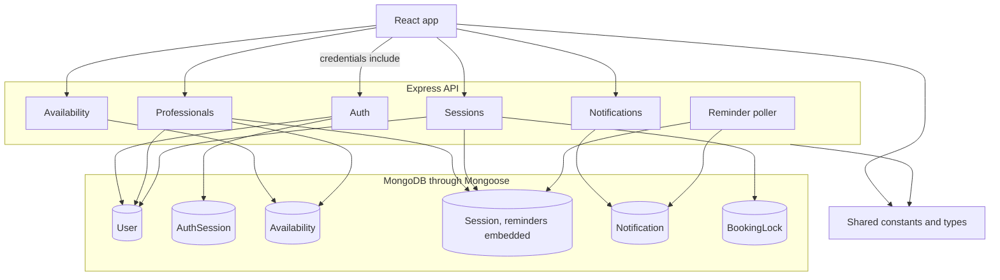
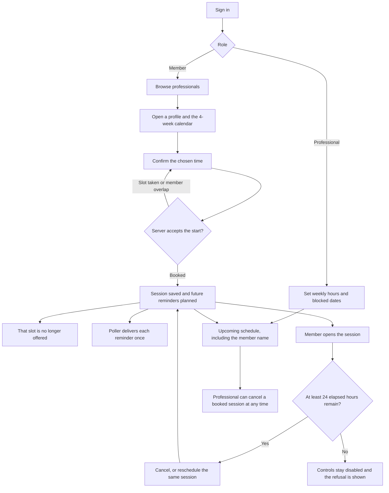

# ThoughtFull session booking

Small booking product for the ThoughtFull engineering assessment. A member finds a professional, sees free 50-minute slots in the member's own timezone, and books a session. Both people receive in-app reminders.

This repository is a TypeScript monorepo. The API stores accounts, availability, sessions, reminders, and notifications with Mongoose. The web app signs people in, then lets a member book a session and a professional publish hours.

## Architecture

The browser never sees the session token. It calls the API with an httpOnly cookie. Both apps share booking constants and response types from `packages/shared`. Reminders live on the session document. A poller in the API process writes each one to `Notification` once.



## Booking flow

Slots are generated on the server from the professional's weekly hours. A start is offered only when it is inside the next 28 days, at least 2 hours away, on an unblocked local date, and not already booked. The member sees that instant in their own timezone.



## Stack

- React, Vite, TypeScript, React Router, Tailwind CSS, TanStack Query, React Hook Form, and Zod
- Node.js, Express, MongoDB, Mongoose, and Zod
- Vitest, Supertest, Playwright, ESLint, and Prettier

## Prerequisites

- Node.js 20 or newer
- npm 11
- Docker, if you want MongoDB, the API, and the web app started together

## Scripts

```bash
npm install
npm run typecheck
npm run lint
npm run format:check
npm test
npm run seed
npm run test:e2e
```

`npm test` runs the workspace unit and API tests. `npm run test:e2e` seeds the demo accounts, starts the API and the web app when they are not already running, and books a session in Chromium. The browser test needs MongoDB on `localhost:27017`. Install the browser once with `npx playwright install chromium`.

## Run locally

Start MongoDB, the API, and the web app:

```bash
docker compose up --build
npm run seed
```

Open `http://localhost:5173`. The API listens on `http://localhost:4000`. MongoDB is published on `localhost:27017`, and its data survives in the `mongo-data` volume. The web image is built to call `http://localhost:4000` from the browser.

To run the processes on the host instead, start only the database:

```bash
docker compose up mongo
cp .env.example .env
cp apps/web/.env.example apps/web/.env
npm install
npm run seed
npm run dev:api
npm run dev:web
```

`GET http://localhost:4000/api/health` returns `200` when Mongoose is connected and `503` when it is not.

### Demo accounts

`npm run seed` creates or resets these two fictional accounts. The password for both is `correct-horse`.

| Name       | Email                  | Role         | Timezone         |
| ---------- | ---------------------- | ------------ | ---------------- |
| Maya Chen  | maya.chen@example.com  | Member       | America/New_York |
| Priya Shah | priya.shah@example.com | Professional | America/New_York |

Priya's hours are 09:00–17:00 every day in that timezone, with no blocked dates. Other accounts in the database are left alone.

Signed-in requests use an httpOnly `session` cookie. The API never trusts a user id sent by the client.

- `POST /api/auth/register`
- `POST /api/auth/login`
- `POST /api/auth/logout`
- `GET /api/auth/me`
- `GET /api/professionals`
- `GET /api/professionals/:id`
- `GET /api/professionals/:id/slots`
- `GET /api/availability/me`
- `PUT /api/availability/me`
- `POST /api/availability/me/blocked-dates`
- `DELETE /api/availability/me/blocked-dates/:date`
- `POST /api/sessions`
- `GET /api/sessions?when=upcoming|past`
- `GET /api/sessions/schedule`
- `GET /api/sessions/:id`
- `POST /api/sessions/:id/cancel`
- `POST /api/sessions/:id/reschedule`
- `GET /api/notifications`
- `POST /api/notifications/:id/read`
- `POST /api/notifications/read-all`

## Layout

- `apps/api` — HTTP API
- `apps/web` — browser application
- `packages/shared` — booking constants and API contract types
- `e2e` — Playwright booking path
- `DECISIONS.md` — choices that are not fixed by the assessment
- `AI_USAGE.md` — how the coding agent was used

GitHub Actions runs format, lint, typecheck, unit tests, and the Playwright path on pushes and pull requests to `main`.

Do not commit `.env`.

