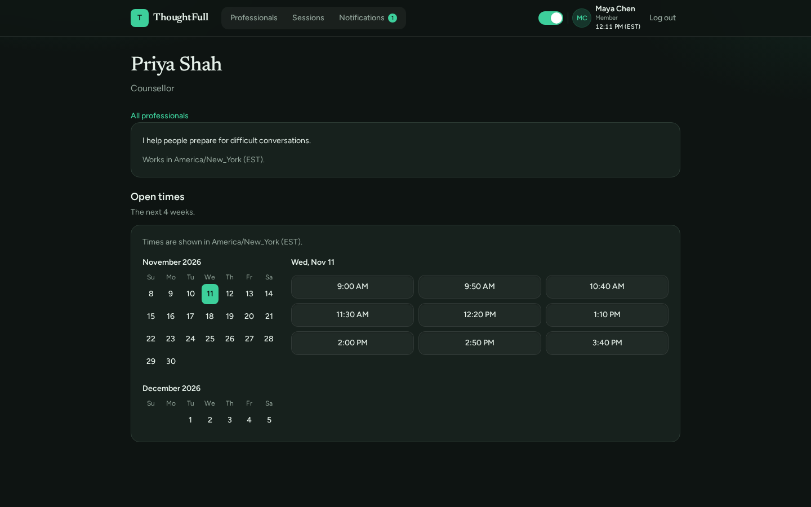
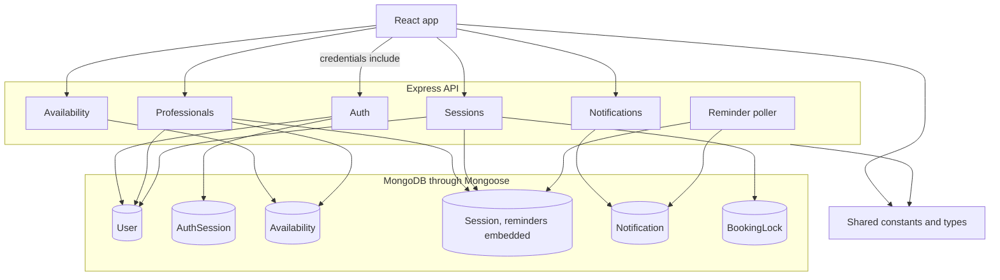
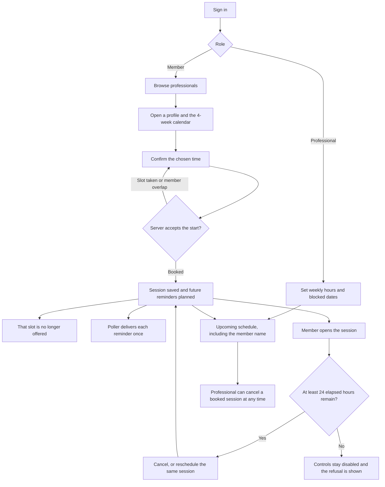
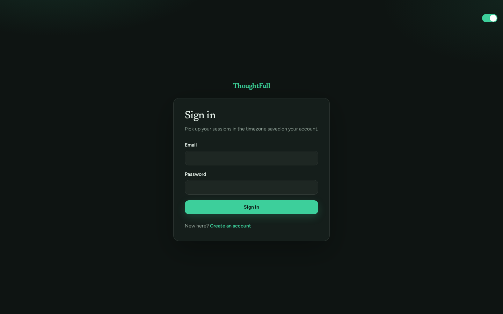
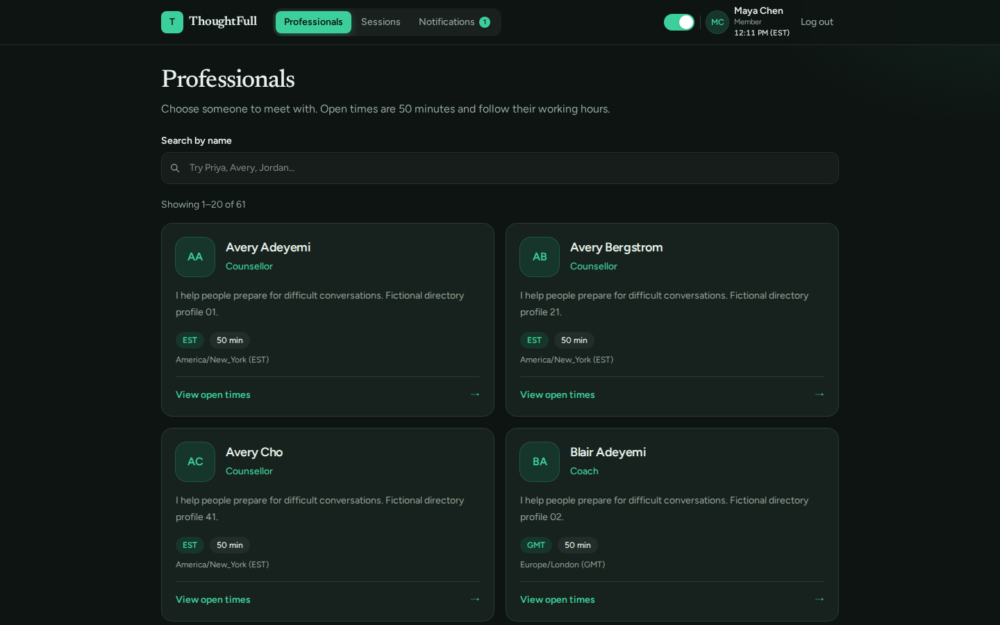
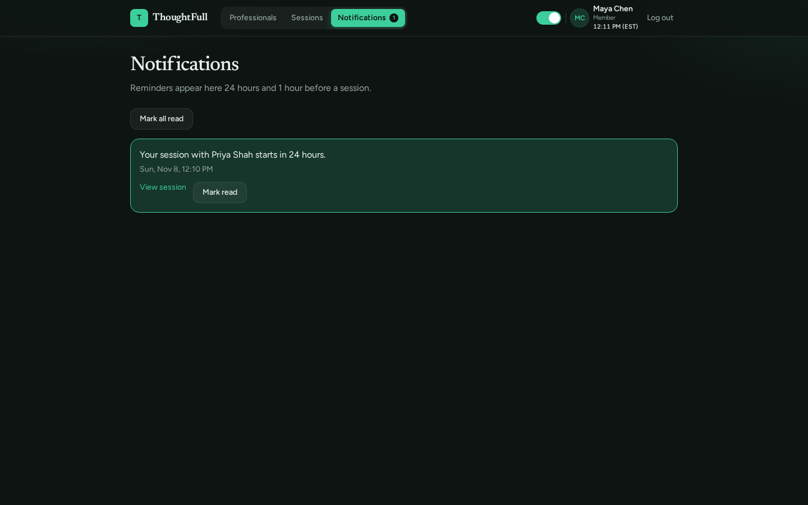
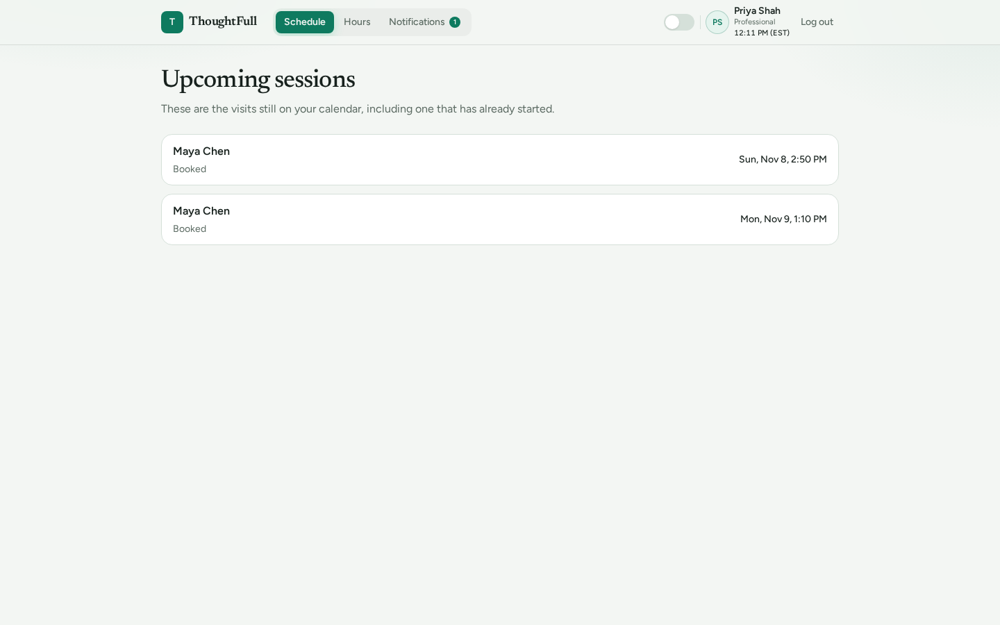
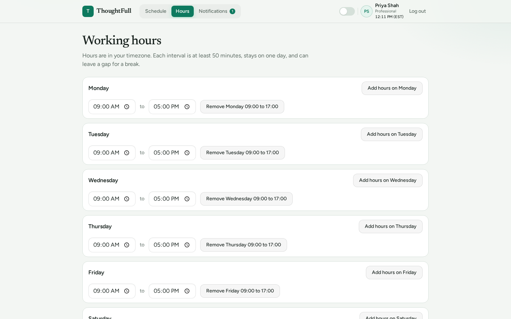
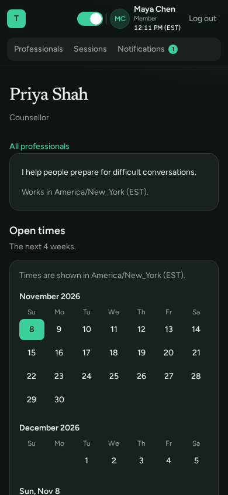

# ThoughtFull session booking

Small booking product for the ThoughtFull engineering assessment. A member finds a professional, sees free 50-minute slots in the member's own timezone, and books a session. Both people receive in-app reminders.

This repository is a TypeScript monorepo. The API stores accounts, availability, sessions, reminders, and notifications with Mongoose. The web app signs people in, then lets a member book a session and a professional publish hours.

The interesting parts are the ones a calendar gets wrong easily: slots are built from wall-clock hours in the professional's timezone and shown in the member's, daylight-saving gaps are skipped, two people racing for the same start get one booking and one `409`, and each reminder becomes exactly one notification even if the poller is restarted mid-delivery.



## Architecture

The browser never sees the session token. It calls the API with an httpOnly cookie. Both apps share booking constants and response types from `packages/shared`. Reminders live on the session document. A poller in the API process writes each one to `Notification` once.



## Booking flow

Slots are generated on the server from the professional's weekly hours. A start is offered only when it is inside the next 28 days, at least 2 hours away, on an unblocked local date, and not already booked. The member sees that instant in their own timezone.



## Screens

All data in these captures comes from the seed: fictional people, `example.com` addresses.

| Sign in                                                                   | Directory                                                                                 |
| ------------------------------------------------------------------------- | ----------------------------------------------------------------------------------------- |
|                      |  |
| **Notifications**                                                         | **Professional schedule (light theme)**                                                   |
|  |           |
| **Working hours (light theme)**                                           | **Phone, 390 px**                                                                         |
|    |                           |

## Stack

- React, Vite, TypeScript, React Router, Tailwind CSS, TanStack Query, React Hook Form, and Zod
- Node.js, Express, MongoDB, Mongoose, and Zod
- Vitest, Supertest, Playwright, ESLint, and Prettier

## Prerequisites

- Node.js 22.22.2 or newer (`.nvmrc` pins 22, the version the Dockerfiles use)
- npm 10 or newer
- Docker, if you want MongoDB, the API, and the web app started together

## Scripts

```bash
npm install
npm run typecheck
npm run lint
npm run format:check
npm test
npm run seed
npm run test:e2e
```

`npm test` runs the workspace unit and API tests: 106 Vitest cases across 27 files. The API suites start a throwaway `mongod` through MongoDB Memory Server, so they need no running database. `npm run seed` inserts the demo accounts when they are missing and leaves existing demo data unchanged. `npm run test:e2e` runs that seed, starts the API and the web app when they are not already running, and books a session in Chromium. The browser test needs MongoDB on `localhost:27017`. Install the browser once with `npx playwright install chromium`.

## Run locally

Open `http://localhost:5173` after either path below. The API listens on `http://localhost:4000`. `GET http://localhost:4000/api/health` returns `200` when Mongoose is connected and `503` when it is not.

The first start inserts the demo accounts when they are missing. Starting again leaves those accounts, their hours, sessions, and notifications as they are. Bookings you make stay in MongoDB.

### Docker

One command starts MongoDB, inserts the demo accounts when they are missing, and starts the API and the web app:

```bash
docker compose up --build
```

The web image is built to call `http://localhost:4000` from the browser. Compose publishes ports 5173, 4000, and 27017, so stop anything else on them first. MongoDB is published on `localhost:27017`. Its data survives in the `mongo-data` volume, including after `docker compose down`. The next `docker compose up --build` sees the existing demo data and does not write over it. `docker compose down -v` deletes that volume, so the following start inserts the demo accounts again. Stop a foreground stack with Ctrl+C.

### On the host

Use this when you want the API and the web app running from the repository instead of the containers.

Start the database:

```bash
docker compose up mongo
```

In a second terminal, from the repository root:

```bash
cp .env.example .env
cp apps/web/.env.example apps/web/.env
npm install
npm run seed
npm run dev:api
```

In a third terminal:

```bash
npm run dev:web
```

`npm run seed` inserts the demo accounts when they are missing. Run it again after the database already has them and it leaves the existing rows unchanged. The same MongoDB volume is used here and in the Docker path above.

### Demo accounts

The seed creates these two fictional accounts. The password for both is `correct-horse`.

| Name       | Email                  | Role         | Timezone         |
| ---------- | ---------------------- | ------------ | ---------------- |
| Maya Chen  | maya.chen@example.com  | Member       | America/New_York |
| Priya Shah | priya.shah@example.com | Professional | America/New_York |

Priya's hours start at 09:00–17:00 every day in that timezone, with no blocked dates. The seed also inserts 60 more fictional professionals, `directory.01@example.com` through `directory.60@example.com`, with the same password. Their hours are Monday–Friday 09:00–17:00. The directory lists 20 people per page, so Previous and Next appear. Accounts outside this seed are left alone.

The header has a Light / Dark switch. The browser remembers the choice.

The first seed also creates one upcoming session between Maya and Priya. Its 24-hour reminder is already due, so both accounts have an in-app notification. Open Notifications after signing in as either of them. The 1-hour reminder stays pending until an hour before the session. A later start does not create another copy of that session, and it does not reset hours, passwords, or reminders that are already stored.

Signed-in requests use an httpOnly `session` cookie. The API never trusts a user id sent by the client.

- `POST /api/auth/register`
- `POST /api/auth/login`
- `POST /api/auth/logout`
- `GET /api/auth/me`
- `GET /api/professionals`
- `GET /api/professionals/:id`
- `GET /api/professionals/:id/slots`
- `GET /api/availability/me`
- `PUT /api/availability/me`
- `POST /api/availability/me/blocked-dates`
- `DELETE /api/availability/me/blocked-dates/:date`
- `POST /api/sessions`
- `GET /api/sessions?when=upcoming|past`
- `GET /api/sessions/schedule`
- `GET /api/sessions/:id`
- `POST /api/sessions/:id/cancel`
- `POST /api/sessions/:id/reschedule`
- `GET /api/notifications`
- `POST /api/notifications/:id/read`
- `POST /api/notifications/read-all`

### Example exchange

Captured against `docker compose up --build` with the seeded data. Ids and times will differ on your machine.

```http
POST /api/auth/login
{"email":"maya.chen@example.com","password":"correct-horse"}

HTTP 200
Set-Cookie: session=<token>; Path=/; Expires=Sun, 15 Nov 2026 17:06:05 GMT; HttpOnly; SameSite=Lax
{"user":{"id":"6af0aa19b1acadccef982086","name":"Maya Chen","email":"maya.chen@example.com","role":"member","timezone":"America/New_York"}}
```

```http
GET /api/professionals/6af0aa19b1acadccef982087/slots

HTTP 200
{"slots":[{"startAt":"2026-11-08T19:50:00.000Z","endAt":"2026-11-08T20:40:00.000Z"},
          {"startAt":"2026-11-08T20:40:00.000Z","endAt":"2026-11-08T21:30:00.000Z"},
          {"startAt":"2026-11-09T14:00:00.000Z","endAt":"2026-11-09T14:50:00.000Z"}, ...]}
```

```http
POST /api/sessions
{"professionalId":"6af0aa19b1acadccef982087","startAt":"2026-12-05T20:40:00.000Z"}

HTTP 201
{"session":{"id":"6af0abfd952af7114bfe0268","memberId":"6af0aa19b1acadccef982086","professionalId":"6af0aa19b1acadccef982087","memberName":"Maya Chen","professionalName":"Priya Shah","startAt":"2026-12-05T20:40:00.000Z","endAt":"2026-12-05T21:30:00.000Z","status":"booked"}}
```

Sending the same booking again:

```http
HTTP 409
{"error":{"code":"slot_unavailable","message":"That time is not available"}}
```

Without the cookie, any signed-in route answers `401 {"error":{"code":"unauthenticated","message":"Sign in to continue"}}`.

## Layout

- `apps/api` — HTTP API
- `apps/web` — browser application
- `packages/shared` — booking constants and API contract types
- `e2e` — Playwright booking path
- `DECISIONS.md` — choices that are not fixed by the assessment
- `AI_USAGE.md` — how the coding agent was used
- `docs/screenshots` — the captures above

Do not commit `.env`.

## License

MIT. See `LICENSE`.
